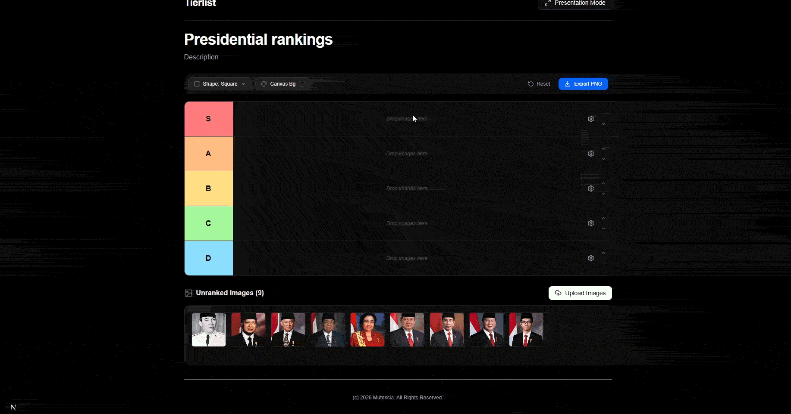

# Tierlist

A fast, modern, and intuitive drag-and-drop tier list builder built with Next.js, React 19, and Tailwind CSS. Create, customize, and export professional tier lists directly in your browser.



---

## ✨ Features

- **Intuitive Drag-and-Drop**: Easily drag images between the unranked pool and tier rows, or reorder items within rows using native HTML5 drag-and-drop.
- **Image Aspect Ratios & Shapes**:
  - Square (`1:1`)
  - Landscape (`16:9`)
  - Portrait (`3:4`)
  - Round / Circle
  - No-Crop (Natural aspect ratio)
- **Customizable Tier Rows**:
  - Editable tier labels inline
  - Customizable color badges with pre-set swatches or custom hex picker
  - Add tiers above/below, move tiers up/down, clear rows, or delete tiers
- **Canvas & Theme Customization**:
  - Customizable canvas background swatches (Deep Zinc, Pure Dark, Clean Slate, Soft Light, Warm Sand)
  - Editable title and description
- **High-Resolution PNG Export**: Export clean, 2x pixel ratio PNG images using `html-to-image`, automatically filtering out UI controls and buttons.
- **Presentation Mode**: Toggle a distraction-free layout optimized for streaming, presenting, and screenshots.
- **Batch Image Uploads**: Upload multiple images at once via file picker or by dragging image files directly from your computer into the dropzone.
- **Client-Side Privacy**: All image manipulation and rendering happen locally in your browser—no images are uploaded to any external server.

---

## 🛠️ Tech Stack

- **Framework**: [Next.js 16](https://nextjs.org/) (App Router, Turbopack)
- **Library**: [React 19](https://react.dev/)
- **Styling**: [Tailwind CSS v4](https://tailwindcss.com/)
- **Icons**: [Lucide React](https://lucide.dev/)
- **Export Engine**: [html-to-image](https://github.com/bubkoo/html-to-image)
- **Language**: [TypeScript](https://www.typescriptlang.org/)
- **Package Manager**: [Bun](https://bun.sh/) (also compatible with npm, pnpm, yarn)

---

## 🚀 Getting Started

### Prerequisites

Ensure you have [Bun](https://bun.sh/) (recommended) or [Node.js](https://nodejs.org/) (v18+) installed on your system.

### Installation

Clone the repository and install dependencies:

```bash
# Clone the repository
git clone https://github.com/your-username/tierlist.git
cd tierlist

# Install dependencies using Bun (recommended)
bun install

# Or using npm
npm install
```

### Running in Development

Start the development server with Turbopack:

```bash
bun dev
# or
npm run dev
```

Open [http://localhost:3000](http://localhost:3000) in your browser to start building tier lists.

### Building for Production

To create an optimized production build:

```bash
bun run build
bun start
# or
npm run build
npm run start
```

---

## 📖 How to Use

1. **Add Images**: Click **Upload Images** or drag and drop image files from your computer into the **Unranked Images** pool dock.
2. **Rank Items**: Drag items from the pool onto any tier row. You can reorder images or drag them back to the dock to unassign them.
3. **Customize Tiers**:
   - Click any tier label to rename it.
   - Click the color badge to pick a preset or custom hex color.
   - Use the row control gear to add rows above/below, move rows up/down, or clear/delete rows.
4. **Change Styling**:
   - Use the **Shape** dropdown in the toolbar to change image aspect ratios.
   - Click **Canvas Bg** to switch the background contrast.
5. **Presentation Mode**: Click **Presentation Mode** in the header to hide unnecessary UI elements for a cleaner view.
6. **Export**: Click **Export PNG** to save your completed tier list as a high-resolution image file.

---

## 📁 Project Structure

```text
tierlist/
├── docs/
│   └── gif/
│       └── demo.gif             # Demo animation
├── src/
│   ├── app/
│   │   ├── globals.css          # Tailwind CSS configuration & base styles
│   │   ├── layout.tsx           # Root HTML layout and metadata
│   │   └── page.tsx             # Main page container
│   ├── components/
│   │   └── tierlist/
│   │       ├── AppHeader.tsx          # Navigation header & presentation mode toggle
│   │       ├── AppFooter.tsx          # Footer component
│   │       ├── ColorPickerPopover.tsx # Color picker for tiers and canvas
│   │       ├── ConfirmDialog.tsx      # Reset confirmation modal
│   │       ├── HeaderSection.tsx      # Editable title & description
│   │       ├── ImagePoolDock.tsx      # Unranked images dock & drop target
│   │       ├── RowControls.tsx        # Row actions dropdown (move, add, delete)
│   │       ├── TierImageCard.tsx      # Individual draggable image component
│   │       ├── TierLabel.tsx          # Editable tier title & color badge
│   │       ├── TierListBoard.tsx      # Primary state integration & export handler
│   │       ├── TierListCanvas.tsx     # Canvas container for tier rows
│   │       ├── TierRow.tsx            # Single tier row component
│   │       ├── Toolbar.tsx            # Shape selector, bg picker, reset, export
│   │       └── useTierListState.ts    # Central custom hook managing tier list state
│   ├── lib/
│   │   └── colorUtils.ts        # Color calculation and luminance helpers
│   └── types/
│       └── tierlist.ts          # TypeScript type definitions and constants
├── package.json
└── tsconfig.json
```

---

## 📄 License

Copyright (c) 2026 Muteksia. All Rights Reserved. See [LICENSE](LICENSE) for details.
